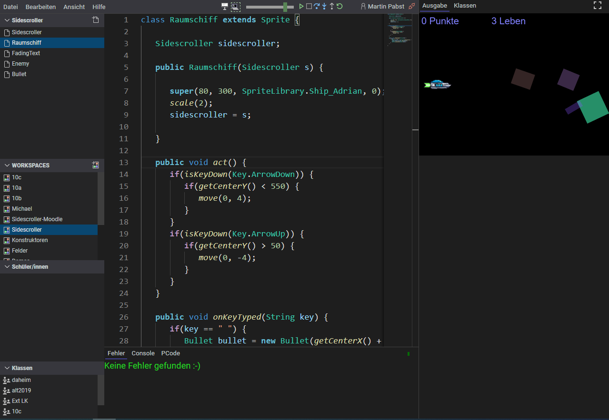

# Java-IDE mit SAS

Dieses Repository erweitert die [Online-IDE von Martin Pabst](https://github.com/martin-pabst/Online-IDE-new-compiler)
um SAS, SASIO und die NRW-Bibliothek sowie Workspace-Dateiuploads und die
Einbindung in digitale Schulbuchseiten. Die Rechte an SAS und SASBlockly
liegen bei net-schulbuch.de gUG (haftungsbeschränkt). Die Lizenz des
IDE-Projekts ist in [LICENSE](LICENSE) enthalten; weitere Hinweise stehen in
[sas-book-demo/lizenzen.html](sas-book-demo/lizenzen.html).

### Lokal starten

```sh
npm install
npm run dev
```

Die SAS-Beispielseite ist unter `http://localhost:3000/sas-book-demo/index.html`
erreichbar. Für ein statisches Serverpaket:

```sh
npm run build-sas-web
```

Die erzeugten Dateien liegen in `upload/java-ide/`, das ZIP-Paket in
`upload/sas-java-ide-web.zip`. Diese Build-Dateien werden nicht in Git gespeichert.
Details: [Server-Upload](documentation/sas-web-upload.md) und
[Schulbuch-Shortcuts](documentation/java-shortcuts-installation.md).

## Ursprüngliche Online-IDE
Programmiersprache, die eine [große Teilmenge von Java](https://learnj.de/doku.php?id=unterschiede_zu_java:start) umfasst zusammen mit einer Entwicklungsumgebung (mit Compiler, Interpreter und Debugger), die **komplett im Browser** ausgeführt wird.

Die IDE gibt es in zwei Varianten: als **[Online-IDE für Schulen](https://www.online-ide.de)** zur Verwendung im Unterricht und bei den Schüler/innen zu Hause sowie als kleine **[Embedded-IDE](#2-embedded-ide)** (Open Source, GNU GPL v3), die in beliebige Webseiten eingebunden werden kann und mit der beispielsweise Informatiklehrkräfte begleitend zum Unterricht eine interaktive Dokumentation für die Schüler/innen erstellen können. Die [Dokumentation der Programmiersprache zusammen mit einem umfangreichen interaktiven Java-Kurs finden Sie hier.](https://www.learnj.de)

## 1. Online-IDE für Schulen

Mit der Online-IDE können Schüler/innen im Browser [in einer Java-ähnlichen Programmiersprache](https://www.learnj.de/doku.php?id=unterschiede_zu_java:start) programmieren. Die Programme werden auf dem Server gespeichert, sodass zu Hause dieselbe Programmierumgebung bereitsteht wie in der Schule - ganz ohne Installation.

Die Lehrkraft hat Zugriff auf die Workspaces der Schüler/innen, sodass sie Hausaufgaben bequem korrigieren und bei Programmfehlern schnell helfen kann.

**Weitere Features**:
  - Integriertes Repository für Gruppenarbeiten
  - Code-Vervollständigung, Parameterhilfe, Refactor->Rename, Anzeige von Referenzen usw. wie in jeder modernen Entwicklungsumgebung
  - Automatisches Kompilieren und Fehleranzeige während der Eingabe
  - Schneller Programmstart ("Play-Button")
  - Ausführungsgeschwindigkeit regelbar
  - Debugger mit Breakpoints, Anzeige der lokalen Variablen, Watch-Expressions
  - Ausführung wahlweise im Einzelschritt
  - Console-Fenster zur Eingabe und sofortigen Ausführung einzelner Anweisungen
  - Schneller, bequemer Hausaufgaben-Workflow
  - Möglichkeit, elektronische Prüfungen abzuhalten


## 2. Embedded-IDE
Die Java-ähnliche Programmiersprache ist im [LearnJ-Wiki](https://www.learnj.de) ausführlich beschrieben und dort ist die IDE in Embedded-Form auch vielfach zu sehen. Hier [ein schönes Beispiel des vollen Funktionsumfangs!](https://www.learnj.de/doku.php?id=api:documentation:grafik:animation#beispiel_4feuerwerk)

## Integration als <iframe> in Moodle
Mehr dazu [auf dieser Seite.](https://www.embed.learnj.de/createwrapper.html) 

## Build
Nach dem Checkout des Repository können Sie den dist-Ordner mit den fertigen Programmdateien erstellen mittels:
```
    npm install
    npm run build
```

## Integration in eigene Webseiten
Die Integration der Embedded-Version in eigene Webseiten [ist hier beschrieben.](https://learnj.de/doku.php?id=onlineide:integration:start)

Benötigt werden
  - dist/assets/fonts
  - dist/assets/graphics
  - dist/assets/mp3
  - dist/lib
  - dist/online-ide-embedded.css
  - dist/online-ide-embedded.js
